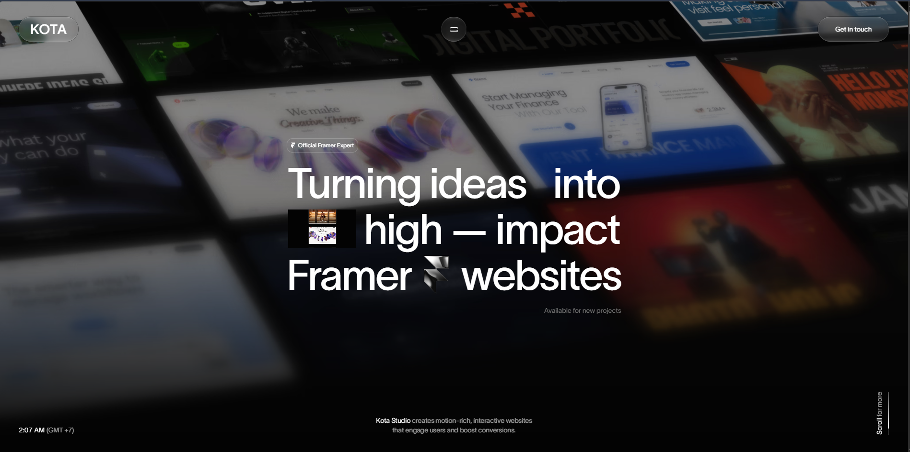
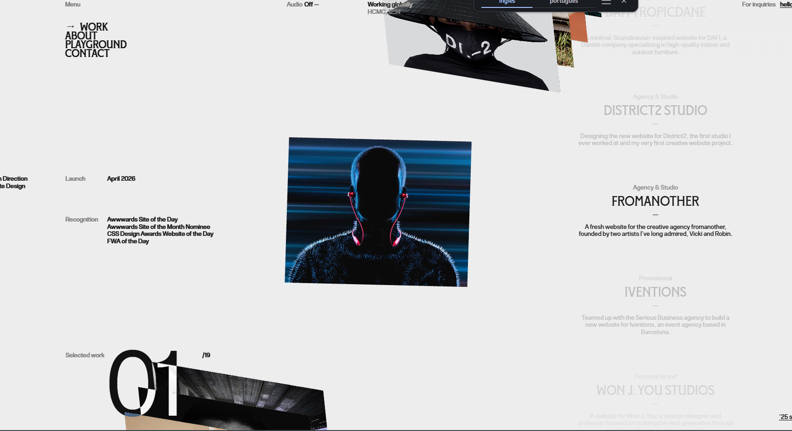

# Atividade 3 — Desenhos da nossa infância

Uma landing page sobre os desenhos que marcaram a infância, criada a partir de um briefing e de duas referências visuais. O projeto combina imagens de personagens conhecidos, uma breve reflexão sobre a importância dos desenhos e um carrossel com descrições de cada universo.

**[Acessar a landing page](https://desenhos-da-nossa-infancia.open-pin-6697.chatgpt.site)** · A versão hospedada foi publicada com acesso privado e pode exigir a conta do proprietário. Para visualizar o projeto localmente, siga as instruções abaixo.

## A proposta

A ideia era criar uma página chamada **Desenhos da nossa infância**, começando com desenhos conhecidos para despertar a nostalgia de quem visita. Entre a abertura e o carrossel, a página deveria apresentar, de forma resumida, como essas histórias fazem parte da vida das pessoas.

Os desenhos representam momentos de diversão, estimulam a imaginação e ajudam a construir lembranças sobre amizade, diferenças e descobertas. A página apresenta essa mensagem em um texto afetivo, ligado à experiência de chegar da escola e assistir à televisão.

## Como a ideia evoluiu

1. **Esboço inicial:** começar com um desenho famoso, apresentar um breve texto sobre a importância dos desenhos e terminar com um carrossel infinito com 5 desenhos.
2. **Primeiro prompt detalhado:** ampliar a abertura para uma composição com vários desenhos e pedir uma seleção de cerca de 10 títulos, cada um com uma descrição curta. Também foram definidas a paleta, a transição suave e as duas referências visuais.
3. **Segundo prompt:** permitir que a roda do mouse trocasse o desenho selecionado, sem depender de cliques nos botões.

A versão incluída nesta pasta corresponde ao resultado desenvolvido na conversa: **10 desenhos**, navegação circular pelos botões e seleção direta, além de navegação pela roda do mouse. Na navegação por scroll, chegar ao primeiro ou ao último item libera a rolagem da página na direção correspondente, permitindo continuar a leitura.

O esboço com 5 desenhos e carrossel infinito foi preservado neste registro como parte da concepção do projeto; o prompt detalhado posterior orientou a quantidade da implementação entregue.

## Estrutura da experiência

- **Abertura:** colagem inclinada com imagens de desenhos como Gumball, Gravity Falls, Shrek e Mickey Mouse, acompanhada do título e de um convite para relembrar a infância.
- **Transição:** o fundo se dissolve gradualmente em uma área clara conforme o visitante desce a página.
- **Importância dos desenhos:** texto breve sobre memória afetiva, imaginação, amizade e acolhimento.
- **Carrossel:** imagem central em destaque, desenhos vizinhos esmaecidos, contador e descrição curta do título selecionado.
- **Encerramento:** mensagem de nostalgia e um link para voltar à seleção de desenhos.

## Referências visuais enviadas

As duas imagens abaixo foram fornecidas como inspiração de composição e interação. Elas são referências de outros sites, e não capturas da landing page pronta.

### 1. Inspiração para a abertura

A primeira referência orientou a composição com imagens inclinadas ao fundo, título grande em primeiro plano e sensação de profundidade. Na landing page, essa ideia foi adaptada aos desenhos e à paleta clara escolhida.



### 2. Inspiração para o carrossel

A segunda referência orientou a imagem central em destaque, os elementos vizinhos em perspectiva e o texto associado ao item selecionado.



## Paleta de cores

| Cor | Código | Aplicação prevista |
| --- | --- | --- |
| Paper White | `#F9F8F6` | Base dominante, cerca de 60%, para uma leitura limpa e para destacar as ilustrações. |
| Indigo Blue | `#2B4C7E` | Textos, títulos e elementos de navegação. |
| Soft Peach | `#FFD2A5` | Fundos e apoios visuais, compondo com o azul a faixa secundária de cerca de 30%. |
| Sunflower Yellow | `#FFC83B` | Acento de cerca de 10%, reservado aos botões principais e links de ação. |

As proporções descrevem a direção visual do briefing, não uma medição exata dos pixels da página.

## Prompts utilizados

### Ideia inicial

> O que eu quero criar é uma landing page falando sobre Desenhos já começando com um desenho bem famoso de começo e depois ter um carrossel infinito tendo no total 5 desenhos, entre o começo e o carrossel ter uma parte falando o quão importante é os desenhos para as pessoa de forma bem resumida , nome do landing page vai ser Desenhos da nossa infância

### Primeiro prompt — criação da landing page

> The Landing page name will be Desenhos da nossa infância
>
> I would like you to use this image as a reference for creating a landing page centered around cartoons. For the main section, the background should feature various cartoons from our childhood—such as The Amazing World of Gumball and Gravity Falls—along with others like Shrek, Mickey Mouse, and so on. As the user scrolls down, the background should transition—smoothly and gradually—into a brief description of the importance of cartoons in people's lives. Finally, at the bottom, there should be a showcase of about 10 different cartoons, each accompanied by a short description, With the colors used being #FFC83B #2B4C7E #FFD2A5 #F9F8F6
>
> 60% (Dominant): Paper White as a background to keep the reading experience clean and highlight the drawings/illustrations on the page.
>
> 30% (Secondary): Indigo Blue for main text, headings, and headers, paired with Soft Peach for backgrounds of content blocks or cards.
>
> 10% (Accent): Sunflower Yellow, used exclusively for primary buttons, key links, and conversion-related elements.
>
> Use this second photo as inspiration for creating the carousel.

### Segundo prompt — ajuste do scroll do mouse

> Okay, now I just want you to make one final change: when it gets to the part about which ones were part of my childhood, I should be able to just scroll—you know, use the mouse wheel to move past it—and have it change. That’s it. That’s what I want.

Esse ajuste foi implementado para que, ao chegar à área central do carrossel, rolar para baixo avance para o próximo desenho e rolar para cima retorne ao anterior. Uma pequena pausa entre as trocas evita que um único movimento pule vários desenhos.

## Desenhos da versão desenvolvida

1. **O Incrível Mundo de Gumball:** uma família diferente e as aventuras absurdas de Elmore.
2. **Gravity Falls:** os mistérios de um verão vivido pelos irmãos Dipper e Mabel.
3. **Shrek:** amizade e autoaceitação em um conto de fadas fora do roteiro.
4. **Mickey Mouse:** encontros e confusões com uma turma que atravessa gerações.
5. **Hora de Aventura:** Finn e Jake explorando a Terra de Ooo.
6. **Bob Esponja:** alegria nas pequenas coisas e nas amizades da Fenda do Biquíni.
7. **Scooby-Doo:** mistérios resolvidos por uma turma inseparável.
8. **Tom e Jerry:** perseguições e humor que funcionam quase sem palavras.
9. **As Meninas Superpoderosas:** personalidades diferentes que se unem para salvar o dia.
10. **Coragem, o Cão Covarde:** o afeto que faz um cão medroso enfrentar o inexplicável.

## Tecnologias e recursos

- HTML para a estrutura e o conteúdo.
- CSS para a paleta, a composição, a perspectiva, as transições e o layout responsivo.
- JavaScript para o carrossel, a navegação pelo mouse e teclado, o gesto de arrastar e os efeitos de rolagem.
- Google Fonts para as famílias DM Sans, Manrope e Playfair Display.
- Links de navegação, nomes acessíveis para os controles, anúncios de troca de desenho e respeito à preferência por movimento reduzido.

## Como executar

1. Baixe ou clone este repositório.
2. Abra `atividade-03/index.html` no navegador.
3. Mantenha `styles.css`, `app.js`, `favicon.svg` e a pasta `assets` junto do HTML.

O projeto é estático: não exige instalação de dependências nem etapa de build. As imagens estão no repositório. A conexão com a internet é usada para carregar as fontes do Google; sem ela, o navegador utiliza as fontes alternativas definidas no CSS.

Também é possível abrir a pasta com a extensão Live Server do editor ou usar um servidor HTTP local de sua preferência.

### Controles do carrossel

- **Roda do mouse para baixo:** próximo desenho quando o carrossel está centralizado.
- **Roda do mouse para cima:** desenho anterior.
- **Extremos da lista:** a rolagem da página continua normalmente na direção de saída.
- **Botões e indicadores:** navegação alternativa e seleção direta dos 10 desenhos.
- **Teclado:** com o carrossel em foco, use as setas para a esquerda/direita; `Home` seleciona o primeiro e `End`, o último.
- **Celular:** arraste a imagem horizontalmente ou use os controles.

## Organização dos arquivos

```text
atividade-03/
├── README.md
├── index.html
├── styles.css
├── app.js
├── favicon.svg
├── fontes-das-imagens.json
├── assets/                         # Imagens dos 10 desenhos
└── referencias/
    ├── inspiracao-landing-page.png  # Primeira imagem enviada
    └── inspiracao-carrossel.png     # Segunda imagem enviada
```

## Verificação realizada

A versão entregue foi conferida em tela de computador e em largura de celular. Foram verificados o carregamento das imagens, a seleção dos desenhos, os botões, a navegação por teclado, o gesto de arrastar e a troca pela roda do mouse, incluindo a saída da seção nos extremos da lista.

## Imagens e créditos

O projeto foi desenvolvido com auxílio do Codex a partir dos prompts e das referências fornecidos. Os endereços e créditos das imagens dos desenhos estão registrados em [`fontes-das-imagens.json`](./fontes-das-imagens.json). As capturas de inspiração foram fornecidas pelo autor do briefing e pertencem aos respectivos sites e criadores.

Personagens, marcas e imagens pertencem aos seus respectivos titulares. Esta atividade é uma homenagem e um exercício de front-end; não representa um site oficial das obras citadas.
